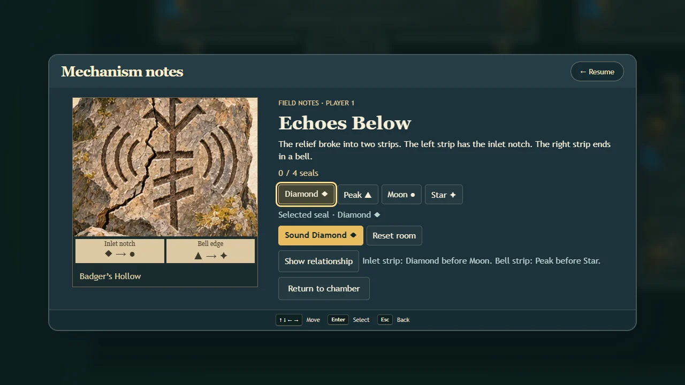
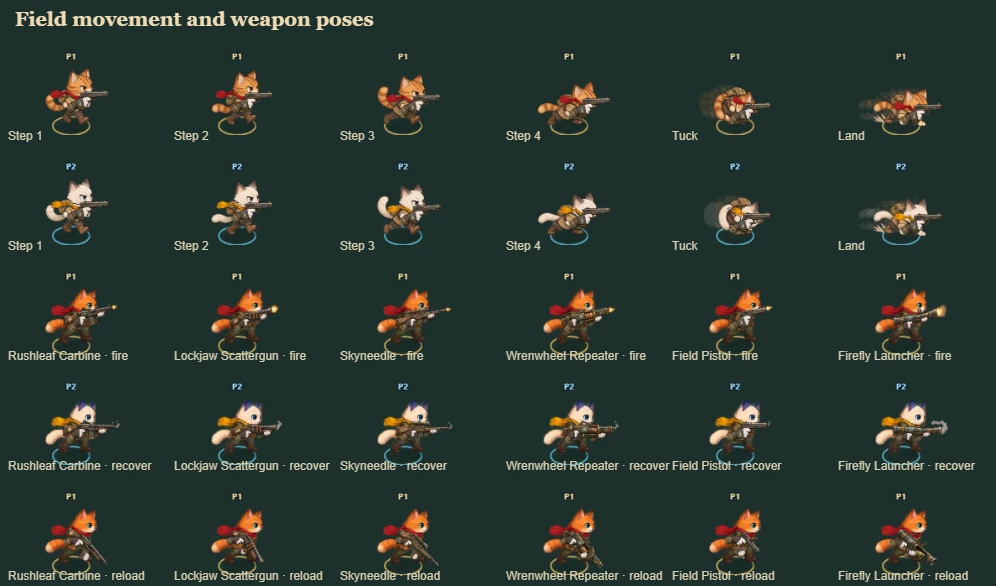
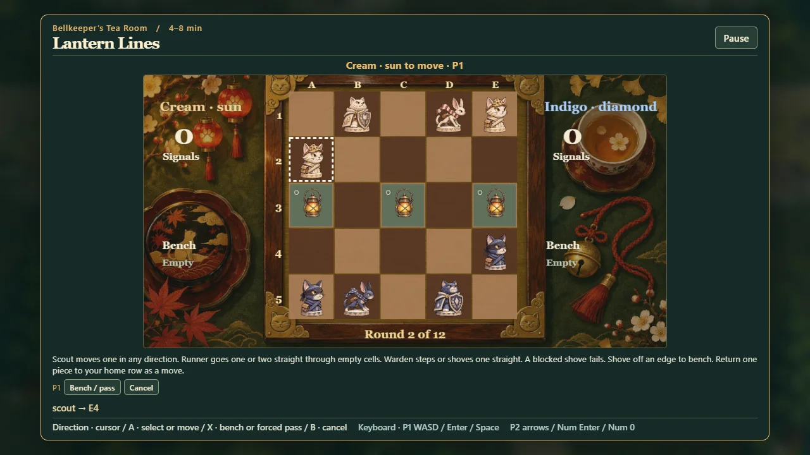
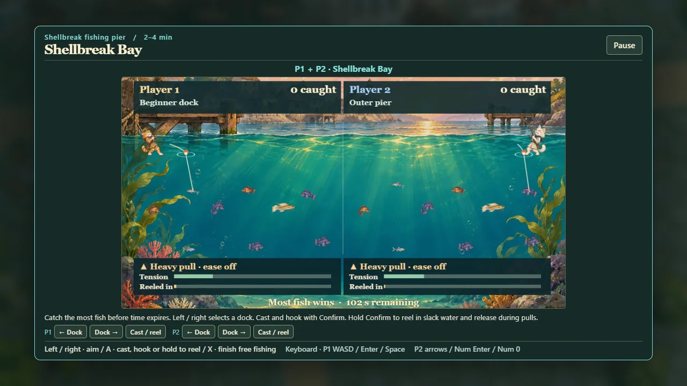
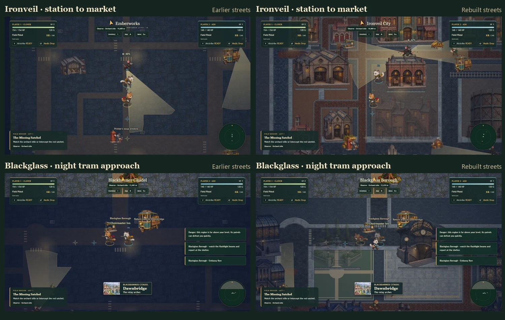

# Chambers, combat and workshop field notes

## Read the room

Interact with the painted relief inside a mechanism chamber to inspect it. Either hero can open the notes. The hero who opened them controls the menu. The selected device is named and highlighted. The same turn can be made with a shot or by interacting beside the device. Completed seals stay open.

| Mechanism | What changes in the room | How to recover |
| --- | --- | --- |
| Echo relief | Two fragments show ordered pairs of symbols. The inlet notch and bell edge identify which fragment comes first. The seals light as the hero sounds them. | A wrong note clears the sequence. The relief remains readable. |
| Lamps and mirrors | Light reflects along the marked route. Later rooms require the beam to open a crescent shutter before it can reach the sun receiver. | Every mirror can be turned back. The open shutter holds while the mirrors are repositioned. |
| Water joints | Reconnected elbows carry water to the east wheel. Later rooms also need the upper header to store pressure for the gate piston. | Rotate elbows through a full turn or reset the room. Stored pressure keeps the header filled. |
| Constellation | A touch flips a star and each directly linked neighbor. Progress from a three-star line to irregular five-star charts. The preview names the affected stars. | Touch the star twice, use Undo, or reset to the starting pattern. |

The first hint explains how the devices relate. The second gives a strategy. The third identifies a legal next move from the current position. Rooms visited in older saves retain their original mechanism and partial progress. Newly visited rooms use the revised rules.

## Expedition routes and trials

- **Rimeglass Reservoir** has two lake gangways and a central stone crossing. Prime the west pump, redirect the pressure, prime the east pump, then lock the regulator. A partner on the planks keeps the gangway from flooding.
- **Cindercoil Foundry** has two cooling valves, a nine-second shortcut and two permanent perimeter routes. Either valve can reopen the shortcut. The second latch makes it permanent. A hero already crossing the bridge can finish after the cooling window.
- **Zephyr Reliquary** uses reed, feather and cloud bells. Strike them in rising order, then operate the lens. A hollow note leaves earlier correct bells lit.
- **The Drowned Maw** raises separate pier sections as the anchors engage. Following the ferryman’s order raises the optional return slip. The central pier remains available to both heroes.

Four survival trials use a shelter, ground rods, bilge wheel or divided relay to change the fight. The shelter alternates sides and reduces damage by 40%. Each ground rod can stun an approaching group once per wave. Three seconds at the bilge wheel primes a party heal and clears venom. The divided relay offers ammunition or a two-second squad disruption. Interact to start the next wave when the team is ready.

## Field actions and the Berlin campaign

Each starter scout has four running frames, a tuck and a landing. The cats retain their red and gold scarves. Other equipped outfits use their own painted bodies and joint positions. Every firearm has ready, fire, recovery and reload poses. Primary carbines, scatterguns, marksman rifles, spool guns, pistols and launchers use the new illustrated rows. Specialist weapons retain their measured art and articulate around the equipped outfit’s shoulder. Gunfire and muzzle flashes use the painted barrel point on the equipped weapon. Blades visibly wind up, extend, then recover.

Ricochet warnings follow the reflected path through the room. The roll traverses those segments on impact. Blink warnings follow the attack clock through a stun, freeze or extended warning. Threats about to cross a hero from offscreen indicate the arrival direction at the screen edge.

The Berlin commander begins with committed dueling lanes and a recovery window. Destroying the signal relay interrupts its sweep. During the false retreat, follow the marked landing and watch which co-op partner is targeted. The last stand chains a shorter volley and landing. The six-family automated duel uses a large health reserve and a fixed decision policy to check encounter progression. Human difficulty ratings remain unverified.

After Berlin, three Dawnbridge operations reveal eleventh-rank workshop upgrades. Complete **Unbroken seal** for the Sealed breech firearm pattern, **Lantern census** for the Silent temper blade pattern, or **Against the current** for the Storm binding suit pattern. Each requires rank +10, 940 coins, 75 materials and three cores.

## Venue mastery

| Personal accessory | Earn it | Equipped effect |
| --- | --- | --- |
| Nettle’s Signal Brooch | Win a four-Signal match against Pipkin or another local player. | Standing still tightens spread by 35% and extends range by 12%. |
| Quarry Laurel | Defeat Champion Slate-Ear in the last ranked bout. | Heavy melee strikes deal 20% more damage. |
| Shellbreak Creel | Land eight fish on your own line in a timed catch race, or weigh in a personal best three totaling at least 7 kg in one outing. | Field dressings restore another 15% of maximum health to the wearer and 8% to a nearby partner. |
| Brass Coupler | Complete the expert yard’s three deliveries without a conflict in twelve beats or fewer. | Reloads take 20% less time. |
| Kitehook Spool | Clear all six rings in under 120 seconds without a penalty. In local heats, win the head-to-head. | Dodge recovery takes 18% less time. |

Each reward appears in the owner’s inventory. Repeating a score preserves a single copy. Practice and the fishing NPC never receive equipment.

## Occupied streets

A sentry's beam stops at the same ground-level masonry as the heroes. Separate wings leave gaps for alley entrances. Keeping to the wall hides a hero from the patrol. The second player's exposure is measured independently. A successful shot sends nearby guards toward the sound. Moving quietly behind cover lets the shooter leave the reported spot. Patrols pause and turn at corners before continuing along the next street.

[Watch the 17.52-second normal-speed walk through Ironveil](media/ironveil-street-walk.webm). Both heroes use separate Gamepad API devices. The movie captures the game and its HUD. Twenty-one distinct residents were drawn during the recorded route from the station toward the archive.

Two separate 21-second walks in Chromium 157.0.8103.52 on Windows measured frame pacing at 1366 × 768, with 16 logical cores reported to the browser. The game ran at its normal cadence, with four screenshots per route and video capture disabled for these timings.

| District | Displayed frames | Frame interval, median / 95th percentile | Simulation / drawing, mean | Distinct residents drawn |
| --- | ---: | --- | --- | ---: |
| Ironveil | 1,129 | 17.0 / 26.8 ms | 1.71 / 4.17 ms | 21 |
| Blackglass | 1,057 | 17.3 / 33.1 ms | 1.95 / 4.07 ms | 15 |

## Local release measurements

Eight launches opened a fresh Chrome 157.0.8103.52 process at 1280 × 720, four launches for published commit 659ff9f and four for this build. The order reversed between pairs. Each opened the local game file directly. Windows managed its file cache. The title measurement marks the first animation frame in which the title artwork had decoded.

| Startup measurement | Published median | This build median |
| --- | ---: | ---: |
| Title controls in the document | 0.861 s | 0.930 s |
| Painted title ready to display | 1.216 s | 1.216 s |
| Game ready | 1.314 s | 1.285 s |

Game-ready times ranged from 1.145 to 1.469 seconds on the published tree and from 1.276 to 1.580 seconds on this build. The ranges overlap.

| Live activity | Sample | Frame interval, median / 95th percentile | Mean interval | Mean activity update and painting |
| --- | --- | --- | ---: | ---: |
| Shellbreak Bay | 1,050 intervals with two active controller rods and one fish landed by each hero | 16.7 / 16.9 ms | 16.67 ms | 0.51 ms |
| Lantern Lines | 390 intervals across live human-side moves, Carver Briar’s replies and one rematch | 16.7 / 16.9 ms | 16.88 ms | 0.77 ms |

A level-15 regional Fencer faced a stationary hero with three firearm skill ranks and three upgrades. The hero started 178 world units away, tracked the Fencer’s position and had enough health to survive every hit. Each cell below represents one fixed-seed clear. The earlier comparison in [the combat report](combat-playtest.md) uses the pre-recon campaign baseline.

| Weapon | Published clear | Fieldwork before tuning | Final clear | Incoming damage, published / final | Lunges, published / final |
| --- | ---: | ---: | ---: | --- | --- |
| Field Pistol | 13.12 s | 13.38 s | 10.62 s | 1,435 / 1,326 | 8 / 6 |
| Trench Scattergun | 7.90 s | 8.60 s | 7.08 s | 820 / 884 | 5 / 4 |

The final field health curve gives this region-4 Fencer 1,457 HP compared with 1,637 on the published build. Its fixed lunge deals 221 damage per hit here, up from 205. A sidestep or blade interrupt exposes it for 0.82 seconds with a 35% damage bonus. Standard and extended warnings last 0.58 and 0.87 seconds. Wounded patrols preserve their health fraction through Continue. The opening region retains its previous multiplier. Commanders keep their own health budgets.

## Reproducible checks

Run rules checks with Node. Browser suites use Playwright and accept an installed Chromium executable in CHROME_PATH. Set MEOWQUEST_CAPTURE_DIR to export the chamber, board, fishing and field-motion images.

| Check | Coverage |
| --- | --- |
| tests/chambers.test.cjs | Forty current and legacy room solutions, 180 state-aware hints, undo, reset, invalid inputs and permanently open seals. |
| tests/chambers-browser.cjs | Sixty-five checks through field interactions, local co-op, expedition collisions, wave devices, gate opening, saving and Continue. |
| tests/locked-warnings.test.cjs | Matching ricochet hits at 24, 60 and 120 updates per second and offscreen arrival cues. |
| tests/recon-combat.test.cjs and tests/berlin-loadouts.cjs | Four boss phases, frozen tells, breaks, actual damage and end-to-end clears with six equipment families. |
| tools/test-recon-forge.cjs | Twenty forge patterns, 24 tuning transactions, three +11 masterworks, restrictions, duplicates and save migration. |
| tests/field-motion-browser.cjs | Sixty-five firearms in four distinct rendered phases and both firing directions, 24 blades in three attack phases, twelve scout frames, every gun’s barrel point at four angles, and live projectile checks. |
| tests/controller-venue-browser.cjs | Both board seats, AI reply, disconnect and restore, separate fishing rods, catch banking, equipped rewards, resting and Continue at 1280 × 720 and 1920 × 1080. |
| tests/activity-mastery.test.cjs | Five high-score thresholds, personal eligibility, duplicates and actual equipment effects. |
| tests/city-watch-controllers.cjs | Seventeen live checks of gamepad tram boarding, independent co-op exposure, dodging into masonry cover, patrol alert, last-seen search, empty trigger, audible shot, and two heroes traversing a named alley that also transmits the beam. |
| tests/city-vision.test.cjs | Parallel and outward rays, set-back walls, an open doorway, a thin closing door, agreement with the drawn cone and patrol cornering at 24, 60 and 120 Hz. |
| tests/city-walkthrough.cjs | Two 21-second live street walks. The test records actual painted commuters, gamepad travel, frame pacing and optional screenshots or a normal-speed viewport movie. |

Controller checks use the browser Gamepad API with two emulated standard controllers. Physical controller hardware remains unverified.
